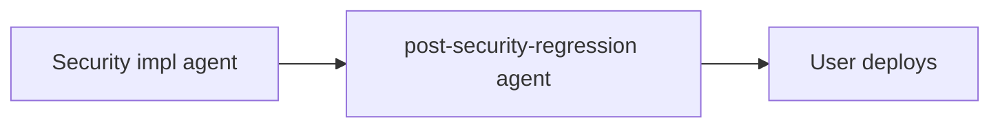

# Security hardening (live-safe)

You are the **security implementation agent**. Cenhub has **live clients** on production.

## Rules

1. **Smallest diff** — one concern per PR (rate limit, RLS, docs).
2. **Fail open on infra errors** — rate limits and logging must not 500 the dashboard if the log table is missing; log and allow (see `enforce-bulk-list-rate-limit.ts`).
3. **Migrations** — additive first; never drop client-visible columns without migration path. Run `npm run db:migrate` only when user expects linked project update.
4. **No auth behavior surprises** — do not tighten funnel/cron Bearer rules without documenting breaking change in `docs/SECURITY.md`.
5. **Always hand off** — end every security task by invoking or summarizing **post-security-regression** checks; do not mark complete without automated tests green.

## Workflow

## Parallel work

- **Implementation agent (this skill):** code + migrations + docs
- **Regression agent (`post-security-regression`):** tests + smoke checklist
- Optional: `ci-investigator` only if CI fails on security PR

Run regression **in parallel** after implementation diff is ready, not only after merge.

## Live rollback levers

Document any new env kill-switch in [docs/LIVE-SAFE-SECURITY-DEPLOYS.md](../../docs/LIVE-SAFE-SECURITY-DEPLOYS.md):

| Lever | Env |
|-------|-----|
| Disable bulk list rate limit | `BULK_LIST_RATE_LIMIT_DISABLED=1` |

## Do not

- Run tenant-isolation against production without user OK (prefer staging)
- Change lead/customer sheet UX in the same PR as security unless required
- Remove fail-open paths to “be more secure” during an incident