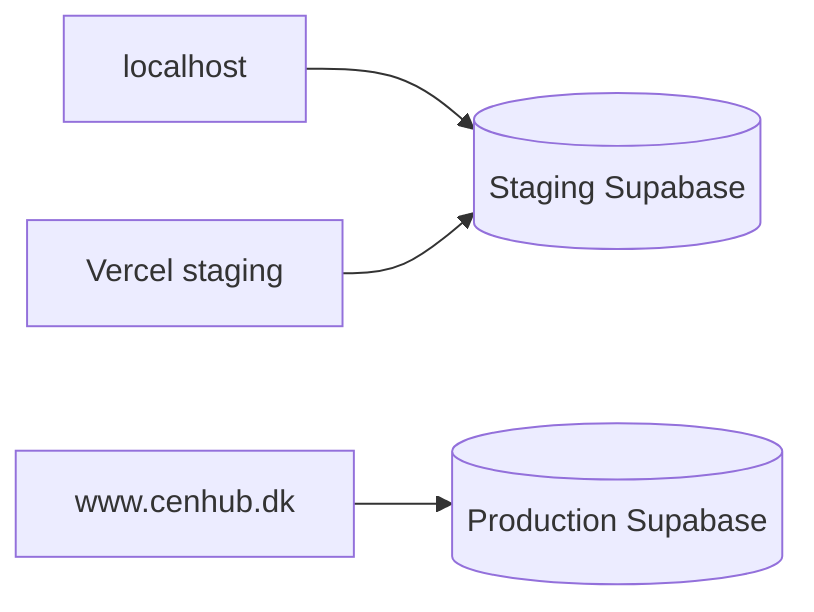

# Three environments: local → staging → production

| Layer | Local | Staging | Production |
|-------|-------|---------|------------|
| App | `npm run dev` → http://localhost:3000 | **staging.cenhub.dk** (branch `staging`) | https://www.cenhub.dk |
| Database | Same as staging (via `.env.local`) | [Cenhub CRM Staging](./STAGING-PROJECT.md) `jyqujippulfaixfawuuc` | `jrywehprthtydlpohuef` |
| Purpose | Dev + migrations first | QA + security tests | Paying clients |



## Golden rules

1. **`.env.local` uses staging Supabase keys** — never production for daily work.
2. **`supabase link` points at staging** — `npm run db:migrate` / `db:migrate:staging` only hits staging.
3. **Production migrations:** `CONFIRM_PROD_MIGRATE=1 npm run db:migrate:prod` only after staging QA.
4. **Production deploy:** merge to `main` → Vercel Production (still uses prod env vars in Vercel).

## Setup checklist

### Supabase

- [ ] Staging project exists ([CLONE-PROD-TO-STAGING.md](./CLONE-PROD-TO-STAGING.md))
- [ ] `supabase link --project-ref <STAGING_REF>` (staging, not prod)
- [ ] Copy [docs/staging.env.example](./staging.env.example) → `.env.local` (fill staging keys)

### Vercel

- [ ] [VERCEL-STAGING.md](./VERCEL-STAGING.md) — Preview env vars, deployment protection, optional domain
- [ ] Production env unchanged (prod Supabase)

### GitHub

- [ ] Actions secrets: **staging** URL, anon, service role
- [ ] Optional: variable `ENABLE_TENANT_ISOLATION_CI=true`

## Daily workflow

### Schema change

1. Add `supabase/migrations/NNN_*.sql`
2. `npm run db:migrate:staging`
3. `npm run dev` — test locally
4. `npm run db:verify-tenant-isolation` (staging DB)
5. Push branch → Vercel staging → click-test
6. `CONFIRM_PROD_MIGRATE=1 npm run db:migrate:prod`
7. Merge `main` → production deploy
8. `npm run security:smoke-prod` + 5 min browser smoke

### App-only change

1. Local against staging `.env.local`
2. Staging deploy → QA
3. Merge `main`

## Promotion checklist (production)

- [ ] Staging tested (leads, customers, one edit)
- [ ] `npm test` + `npm run security:verify-admin-routes`
- [ ] Migrations applied on staging; prod migrate only if SQL changed
- [ ] `npm run security:smoke-prod`
- [ ] No open incident on staging

## Verify local is not on prod

```bash
npm run env:verify-dev
```

## Related

- [VERCEL-STAGING.md](./VERCEL-STAGING.md)
- [STAGING-SECURITY.md](./STAGING-SECURITY.md)
- [LIVE-SAFE-SECURITY-DEPLOYS.md](./LIVE-SAFE-SECURITY-DEPLOYS.md)